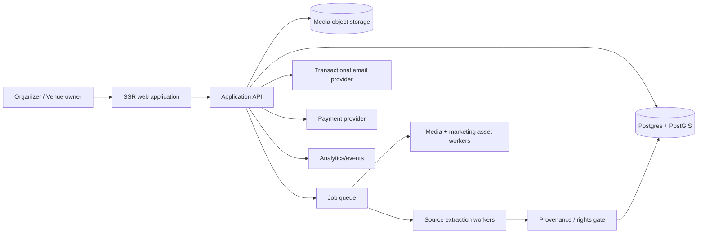

# CTO Product Requirements Document — Swiss Venue Marketplace

**Working title:** Project OPEN VENUE (working name only; brand/domain to be selected)  
**Document:** CTO-PRD-001  
**Version:** 1.0  
**Date:** 7 November 2026  
**Market:** Switzerland, beginning with German-speaking cantons  
**Owner:** Founder / CTO  
**Companion document:** `CMO_PRD_Swiss_Venue_Marketplace.md`  
**Status:** Product blueprint; not a statement that the features are already implemented

---

## 1. Executive decision

Build a Swiss discovery and demand-generation marketplace for event venues that is **cheaper, richer in presentation, and nearly effortless to join**. The product must not ask venue operators to adopt a CRM or change how they handle enquiries. Venues receive booking enquiries directly in their existing email inbox. Any dashboard is optional.

The differentiator is a combination of:

1. **Prebuilt listings:** the platform prepares an accurate preview before asking the operator to invest time.
2. **An attractive free listing:** sufficiently useful to build credible supply.
3. **One all-inclusive paid plan:** **CHF 199/year** as the proposed launch price, for exposure and promotional benefits rather than required workflow software.
4. **An unusually rich venue page:** room-level profiles, extensive authorized photography, embedded video, multilingual presentation, precise filters, brochure downloads and event packages.
5. **Active demand generation:** organizer search, qualified direct enquiries, shortlists, last-minute availability, partnerships and a reverse-match feature.
6. **No lock-in:** no commission, no required CRM, clear cancellation, export and listing removal.

**Non-negotiable reality:** better software and cheaper subscriptions do not produce bookings automatically. The engineering system must make lead quality measurable and facilitate marketing channels that can attract organizers.

### 1.1 North-star outcomes

- **Primary customer outcome:** qualified event enquiries delivered to venues through channels they already use.
- **Primary organizer outcome:** find a suitable, genuine venue quickly and contact it with one clear brief.
- **Primary business outcome:** a recurring, low-overhead CHF 199/year paid listing product. The initial gross revenue objective is **61 paid accounts ≈ CHF 1,011/month in annualized revenue**, before costs and taxes.
- **Operational outcome:** a single developer can maintain the platform without a growing support team.

### 1.2 Initial market and price assumptions

- Geography: Switzerland; pilot supply in Zürich, Aargau, Zug and Bern. Other cantons can enter the catalogue with verified coverage.
- Languages: German first; French, Italian and English as staged localization of interfaces and venue content.
- Venue segments: wedding venues, event halls, seminar rooms, hotels with bookable function rooms, restaurants with private dining and specialized event locations.
- Packages: **Free** and **Pro CHF 199/year**; annual billing, no percentage fee on bookings.
- Indicative commercial baseline: Eventlokale's published downloadable package table lists CHF 177, 449, 949 and 2,498/year before VAT; the publication date of the online PDF is not established, and current checkout terms or other live promotional material may differ. In the PDF, Top Premium offers 48 images and 4 videos, while Top Premium+ offers unlimited images and videos. Never imply these features are absent from the competitor. Raumsuche currently displays a free tier and paid rates at **CHF 19/month** (Premium) and **CHF 49/month** (Superior), not the previously cited CHF 190/490 annual figures. Its Superior tier advertises unlimited rooms and images. Verify contractual billing before converting displayed monthly rates to annual comparisons. Use dated, package-specific comparisons; never assert that our plan beats every competitor's cheapest tier. See Sources.

## 2. Product philosophy and guardrails

**Sell the venue's presence and opportunities, not a new internal process.**

- **No forced account creation to see a prebuilt draft.** Verify operator identity only before editing or publishing rights-sensitive media.
- **No forced SaaS migration.** Enquiries go to an email destination configured by the venue. The optional admin area is for settings, content and reports.
- **No misleading “already verified” status.** A public unclaimed venue must be clearly identified as unclaimed, and generated facts must be reliable.
- **No images without rights.** Authorization to copy a photo from a third-party directory is not presumed from the venue's presence there. The owner's licence must actually cover reuse and derivative marketing materials.
- **No mass competitor database mirroring.** Source factual business information independently, respect site terms, and commission legal review of collection workflows.
- **No fabricated reviews, fabricated availability, fabricated inquiries, invented amenities or made-up performance statistics.**
- **No zero-value programmatic SEO.** Do not index thin, duplicate, unverified or near-identical pages solely to manufacture search volume.
- **No infinite manual work for a CHF 199 customer.** The plan is digital and self-service; human service is intentionally limited.

## 3. Personas and jobs to be done

### 3.1 Venue operator (primary supplier)

A hotel or event venue operator already has a website, photos, staff routines and an inquiry email. They may pay other portals for visibility. They dislike uploading media and re-entering details. They want more legitimate bookings without having to learn another tool.

**Jobs:** (a) appear where organizers search; (b) receive relevant enquiries; (c) be represented accurately; (d) understand whether advertising is worth renewing; (e) avoid unexpected fees.

**Acceptance:** “My page was almost ready before I registered; I spent under five minutes checking it; enquiries arrive by email; I can remove or update the page.”

### 3.2 Organizer (demand)

A bride/groom, office manager, planner or individual needs a space for a date, capacity, budget and geographic radius. They want comparable results, good photography, practical filters and a short enquiry form. They dislike sending repetitive messages to unsuitable venues.

**Acceptance:** “The results fit my constraints; I can compare rooms; I submit one brief and hear from real venues.”

### 3.3 Marketing / operations manager

The founder needs batch preparation, lead-source attribution, prebuilt preview links, quality-control queues, campaign segments, fair promotional allocation, churn monitoring and exportable campaign data.

### 3.4 Moderator / support

Handles ownership disputes, outdated data, photo-rights claims, duplicate listings, alleged spam enquiries and deletion requests without direct database changes.

## 4. Scope: the actual product

### 4.1 Tier definitions and feature entitlements

| Feature | Free | Pro — CHF 199/year |
|---|---|---|
| Core public venue profile | Yes | Yes |
| Owner claim, edit and deletion | Yes | Yes |
| Direct email enquiries | Yes | Yes |
| Main profile photo gallery | Up to 6 approved photos | Extensive gallery; no arbitrary per-listing sales-tier limit, subject to security/fair-use controls |
| Distinct bookable room profiles | 1 basic room | Unlimited genuine bookable spaces, subject to anti-duplication policy |
| Applicable categories | Limited launch categories | All genuinely relevant categories |
| Multiple embedded videos | 1 | Unlimited supported external video embeds with moderation |
| Multilingual venue copy | Basic primary language | DE/FR/IT/EN translated and editable |
| Brochure and event packages | Basic PDF link | Multiple downloadable brochures and clearly priced packages |
| Venue highlight and image presentation | Standard | Enhanced layout, prominent media and clearly labelled sponsored exposure |
| Event-specific or seasonal listing | No | Yes, subject to verification |
| Last-minute available-date promotion | No | Yes, with explicit validity |
| Lead summary | Basic monthly email | Detailed monthly email and optional dashboard |
| Downloadable social-media kit | No | Included template-based assets |
| Auto-generated short promo video | No | One starter video per subscription year; additional regeneration on material updates only |
| Optional inquiry widget / mini-CRM | Optional later | Optional later; not a core promise |
| Commission | 0% | 0% |

**Important:** “Unlimited” applies to legitimate content entities, not limitless free data transfer, transcoding or moderation. Implement rate limiting and a documented fair-use policy. Videos are initially embedded rather than uploaded at our expense. Do not launch claims about unavailable benefits.

### 4.2 Requirement prioritization

- **P0 / launch-blocker:** functional search and listing; unclaimed/prebuilt draft; claim verification; rights-safe image import; organizer enquiry via email; basic reverse-match prototype; Free/Pro; payment and renewal; performance analytics; quality moderation; GDPR/FADP-ready privacy fundamentals; Swiss DE copy.
- **P1 / near-term differentiated offer:** room-level listings; EN/FR/IT translations; scheduled last-minute deals; social collateral and promo video generation; brochures/PDFs; saved shortlists; partner syndication; monthly report; refined ranking.
- **P2 / optional:** sophisticated availability sync; Instagram-ready export variations; deeper marketing integrations; lightweight CRM and embeddable forms; booking calendar, offer builder, e-signature, payments from event customers.

**No full CRM in P0.** Prioritizing it would contradict the core customer insight.

## 5. Critical end-to-end user journeys

### Journey A — Prebuild → preview → claim → publish

1. Admin selects a target venue with sufficiently reliable independent business identifiers.
2. Discovery service gathers permissible factual details: public business name, locality, business address, canonical official site, venue type, broad characteristics, telephone when appropriate, and independently verified facilities.
3. Generate a draft **without assuming any rights to third-party photo assets**. Fetch candidate information from the venue's own domain using configured crawl policy; store source/provenance for review.
4. Build a publish-safe unclaimed profile using non-copyrighted facts and original editorial text, or hold draft private when quality is insufficient.
5. Send a unique invitation link through a permissible outreach channel. The link opens the prebuilt preview without forcing signup.
6. Owner chooses “Claim this venue,” verifies authorized control through the official domain email, DNS, existing business channel or manual evidence.
7. Owner confirms contact details and photo/video licence grants. Show all images selected for publication and allow exclusions.
8. Publish or upgrade claimed profile in a single final confirmation. Show exact price **before** payment and final contract conclusion.
9. Email proof of publication, source URL, settings link and removal option.

**Success target:** median time from a prepared preview opening to approved claim under five minutes, excluding unusual manual verification.

**Failure:** don't silently use a staff member's personal address as proof of legal rights; don't publish owner-claimed rights-sensitive content until verification clears.

### Journey B — Organizer searches and sends a direct enquiry

1. Choose event type, municipality/canton, approximate date, guest count and optional budget.
2. Search results filter by genuinely compatible capacity, geography, event type, indoor/outdoor options and accessibility (if verified).
3. Organizer opens a venue page, navigates room-level galleries, sees facilities and pricing disclosures.
4. Short enquiry includes event type, desired date(s), party size, optional budget, contact email/name and optional free-text notes; disclosures explain delivery.
5. Validate phone/email format, detect spam and rate-limit.
6. Deliver enquiry to venue email with a secure reply-to or reply relay, with a clear request ID and original lead source; optionally notify organizer.
7. Venue replies directly using existing mailbox. No dashboard is necessary.
8. Collect optional post-enquiry delivery/response feedback without claiming a booking occurred.

**Success:** 99.9% of accepted, legitimate enquiries processed without silent loss; alert if email delivery fails and provide fallback.

### Journey C — Reverse venue match (one organizer brief, 3–5 venues)

1. Organizer explicitly opts to send one brief to up to five matched venues, with clear indication the enquiry is being shared.
2. Matching engine filters for geography, verified maximum capacity, event category, venue preferences and optional budget fit.
3. Deduplicate venue owners/parent organization when appropriate.
4. Display matched venue names before submission or reveal the recipients clearly in the consent step.
5. Create one parent request and up to five child deliveries; each venue receives a unique ID and can reply normally.
6. Apply per-venue daily caps or operator opt-out of group distribution; do not sell a brief indiscriminately to dozens of suppliers.
7. Track delivery, opens only where privacy appropriate, replies (only if within our relay), and explicit organizer feedback.

**Success:** real, appropriately matched opportunities; low spam complaint rate; operators can opt out of match broadcasts while keeping standard listing enquiries.

### Journey D — Payment and renewal

1. Operator sees Pro features, exact annual price, currency, VAT treatment, renewal terms and cancellation method.
2. Payment through reputable provider supporting Swiss cards and ideally TWINT; hosted payment UI, no card data storage by us.
3. Upgrade is applied idempotently on verified webhook; invoice/receipt and subscription status are accessible.
4. Send renewal reminders (e.g. 30 and 7 days) and make cancellation online easy. Terms must match actual checkout consent.
5. On non-renewal, profile stays live in the Free state subject to quality and policy, without losing rights-granted materials except as agreed.
6. Reconciliation job validates provider status daily.

### Journey E — Rights complaint / operator removal

1. Operator or rights holder submits concern without needing an account.
2. Triage immediately; disputed media is unpublished pending investigation if credible.
3. Record complaint, provenance, authorization, timestamps and decision.
4. Correct or remove content, notify affected owner where appropriate and maintain an auditable history.
5. Support complete unlisting when requested and legally required; update sitemap and indexing directives promptly.

## 6. Functional specifications and acceptance criteria

### F01 — Venue identity and deduplication (P0)

**Data:** legal/commercial name; alternate brand; street/ZIP/municipality/canton; CH country code; geocoordinates; official domain; external identifiers where licensing permits; venue organization ID; venue ID; room ID; moderation status.

**Rules:** normalization of Swiss addresses and spelling variants; similarity scoring across exact website, phone, address and name; manual review for borderline matches. One property can hold many rooms; do not create several venue businesses for the same hall just to fill inventory.

**Acceptance:** importing an exact website twice creates one draft entity; partial name variants are queued, not duplicated; every public result maps to a real geographic venue.

### F02 — Public listing and media presentation (P0/P1)

A listing includes H1, city/canton, event types, hero photo when licensed, captioned gallery, up to dozens of owner-verified feature chips, separate room cards, capacities by layout when available, link to official site, contact path, venue policies and factual disclosures. Never fill missing price/capacity with guesses.

**Acceptance:** accessible keyboard navigation; usable mobile layout; photos optimized; non-empty alt text; clear attribution/credit where required; visible unclaimed status; no empty placeholders masquerading as features.

### F03 — Prebuild importer (P0)

**Supported source order:** owner-uploaded files > official venue website with permitted access > directly licensed media/library > independently collected factual public source > third-party directory material only with specific documented legal clearance.

**Acquisition:** HTML request with redirects limit; parse canonical, OG/Twitter image metadata, JSON-LD `LocalBusiness`/`ImageObject`, `img`, `srcset`, `picture/source`, `data-src`, CSS background URLs, relevant internal pages, PDF brochures with permission. Use Playwright for JavaScript-rendered pages only after cheap parser fails.

**Page relevance:** prioritize `/galerie`, `/bilder`, `/hochzeit`, `/event`, `/seminar`, `/raeume`, `/salle`, `/wedding`, `/meeting`. Limit crawl to a small page budget, constrain depth, detect sitemaps only where appropriate.

**Image selection:** gather URL + origin + page context + alt/title text + dimensions + format + file size; reject icons/avatars/logos, tiny assets and duplicates using perceptual hash; favor event-space interiors, terraces, ceremony spaces and rooms rather than food or employee headshots. Use heuristics first; optionally apply a cheap image classifier where necessary. Never promise 100% correct automatic selection.

**License checkpoint:** discovered candidate images are **not public assets** until authorization/provenance passes. A source URL is not a licence. No public hotlink workaround for a legally unapproved image.

**Acceptance:** on an agreed 50-site Swiss test set, ≥80% yield a useful draft with venue name and location, ≥70% yield at least three plausible image candidates for owner review, and all published photos have a documented rights basis. Targets to validate, not market claims.

### F04 — Claim, ownership and licence verification (P0)

Allow verified company-domain email with challenge, DNS TXT for technically capable owners, and manual review using business registry/official site contacts. Gmail and generic addresses alone require stronger proof when contested. Signed owner declaration must separately cover (i) ability to manage listing; (ii) photo/video rights and whether promotional derivatives may be created; (iii) source data accuracy; (iv) third-party people/photo consents where relevant. Record revision of policy and proof.

**Acceptance:** no unauthenticated user can claim another venue; repeat claims trigger moderation; authorization is versioned and revocable to extent legally/contractually required.

### F05 — Search and ranking (P0)

**Facets:** country=CH, canton, municipality/radius, event purpose, guest capacity, max price when known, indoor/outdoor, accessible, parking/transit, overnight rooms, catering, room type and late availability. Missing capacity cannot silently pass strict capacity filters.

**Organic ranking:** relevance + reliable content completeness + freshness + regional relevance + actual usefulness signals. Paid placements may appear in clearly labelled inventory slots but must not make the remainder of the results irrelevant.

**Acceptance:** identical filters produce stable results; results never include a venue that explicitly cannot host the requested number of guests; sponsored placements are labelled; search page shows total count and filters that can be cleared.

### F06 — Enquiries, email delivery and anti-spam (P0)

Minimum fields: name, email, event category, date or date flexibility, attendees, message; budget optional. Validate email and require explicit consent for distributing request to venues. Use double-confirmation or adaptive verification for suspicious requests; rate limits by IP/address/device; server-side spam heuristics; CAPTCHA only when needed; short retention for abuse logs.

**Email:** SPF/DKIM/DMARC configured; transactional provider; bounce and complaint webhook; audit events; retry with backoff; dead-letter queue; safe unsubscribe for promotional email separate from operational emails. Avoid sending organizer's PII to analytics tools.

**Acceptance:** recipient knows sender, event date and response address; organizer gets a confirmation; failed delivery is actionable; no inquiry is silently swallowed.

### F07 — Room-level profiles (P1)

Each room belongs to one real venue and has its own title, capacity ranges by configuration, floor area, indoor/outdoor, facilities, galleries, wheelchair-access status, event categories, and room-specific enquiry CTA. Avoid inventing differentiated rooms when one venue merely has one hall.

**Acceptance:** event search can return either venue groups or specific room cards without duplicating the same business excessively; room enquiries identify the exact room.

### F08 — Multilingual presentation (P1)

Locale codes `de-CH`, `fr-CH`, `it-CH`, `en`. UI copy is professionally reviewed and translated using stable translation keys. Venue content may be machine-translated but generated facts must remain factual; mark translations pending review if quality low. Venue owners can override per locale. Respect Swiss regional terminology and price formatting.

**Acceptance:** search page and listing are usable in DE/FR/IT/EN; localized URLs have reciprocal `hreflang`; incomplete languages degrade gracefully; no AI-generated fake attributes.

### F09 — Marketing asset studio (P1)

- Logo/brand and photo rights supplied by venue.
- Outputs: Instagram story/reel cover, square social post, A4 factsheet, QR code and shareable listing link.
- Promo video: programmatically composed slideshow with licensed photos, readable overlays, original or licensed audio if any, 9:16 and optional 1:1 variants; ideally one initial free composition per Pro year. Offer video regeneration after a material update.
- Server-side generation uses an async worker; show review/approval before downloading assets.
- Avoid unauthorized portraits, music or trademarks.

**Acceptance:** 95% of approved inputs render correctly; generated outputs carry proper venue attribution and link; failures retry; owner can disable derivatives.

### F10 — Last-minute dates and packages (P1)

Operators can publish: genuine availability date or period, room, suitable event, indicative package/price, minimum guests, terms, expiry. They can update via a lightweight email link or simple dashboard rather than syncing calendars. The platform never infers actual availability from absence of a booked date.

**Acceptance:** expired deals disappear automatically; dates cannot be in the past; price and conditions are stated; organizer understands availability requires venue confirmation.

### F11 — Brochures and PDF collateral (P1)

Venue may attach a rights-authorized brochure. Platform can also generate structured downloadable factsheets from verified listing fields, with creation date and a note that dates/prices must be confirmed with operator. Sanitise uploaded PDFs and enforce file limits.

### F12 — Reviews and trust (P2)

Initially do not display scraped/star ratings from external sites. Introduce verified firsthand reviews only after reliable transaction evidence, moderation, owner response and anti-fraud safeguards exist. Do not invent aggregateRating structured data.

### F13 — Partner distribution (P1)

Optional venue-owner opt-in to distribution on founder-operated portals or approved external partners. Each syndication relationship specifies image rights, destination, update cadence, link tracking, data deletion and duplicate SEO strategy. No claims of distribution on partners that have not actually agreed.

### F14 — Analytics and reports (P0/P1)

Measure listing visits, unique engaged views, enquiry starts, verified submissions, delivered enquiries, matched requests and downloads. **Do not report bookings or booking revenue without reliable evidence.** Send venue owners a concise monthly email with a fair comparison to previous period, and avoid confusing page views with sales leads.

## 7. Technical architecture

### 7.1 Suggested stack

- **Web:** Next.js or comparable SSR/SSG-capable framework, TypeScript; server-rendered SEO pages.
- **API/application:** TypeScript monolith with clear modules; avoid microservices for a one-person business.
- **Database:** PostgreSQL + PostGIS for geospatial filtering; `pg_trgm` and full-text search initially. Meilisearch/OpenSearch only if search latency or relevance demands it.
- **Jobs:** Redis + BullMQ or database-backed queue if initial volume is very low.
- **Crawl:** Fetch/Cheerio/HTML parser + Playwright fallback, isolated worker network namespace.
- **Media:** S3-compatible object store/CDN, Sharp, ffmpeg worker for promotions.
- **Mail:** reputable transactional email service with delivery webhooks.
- **Billing:** Stripe or Swiss-compatible PSP supporting card payments and ideally TWINT; exact provider to be validated for fees, refunds and Swiss VAT invoices.
- **Infrastructure:** managed hosting, managed Postgres, restricted object storage, secret vault and error monitoring. Choose operational simplicity over fashionable complexity.

### 7.2 Component schematic



### 7.3 Modularity boundaries

`catalogue`, `source_discovery`, `media_rights`, `claiming`, `search`, `inquiries`, `billing`, `promotions`, `localization`, `analytics`, `moderation`, `campaign_operations` and `syndication`. Keep authorization checks in shared domain policies, not scattered route handlers.

## 8. Data model — initial schema inventory

| Entity | Essential fields and purpose |
|---|---|
| `organization` | id, business_name, legal_name?, primary_domain, verified_at, status |
| `venue` | id, organization_id, name, slug, postal address, canton, geopoint, description status, venue type, claim state |
| `space` | id, venue_id, title, capacity_min/max, configuration capacities, feature set, description |
| `venue_translation` | venue_id, locale, title, intro, long_text, translation_origin, review state |
| `source_record` | id, entity_id, source_type, normalized_url, fetch date, verification confidence, evidence reference, terms flags |
| `media_asset` | id, owner, object_key, checksum/phash, dimensions, content type, moderation status, credit, published_at |
| `media_rights_grant` | id, media_id, grantee, grantor, scope, permitted derivative uses, evidence, timestamp, revocation state |
| `venue_media` | venue_id, space_id?, media_id, caption, sort order, cover boolean |
| `claim_request` | id, venue_id, claimant, proof_type, token hash, expiry, review decision, audit trail |
| `user` | id, verified email, auth identities, login audit; personally identifiable data kept minimal |
| `venue_user_role` | venue_id, user_id, role (owner/editor), state |
| `enquiry` | id, organizer identifiers, consent version, event type, date, guest_count, budget range, message, source |
| `enquiry_delivery` | id, enquiry_id, venue_id, room_id?, delivery state, provider ID, bounce status |
| `promotion` | id, venue_id, media creative, type, start/end, allocation slot, labelled advertising flag |
| `last_minute_offer` | id, space_id, start/end, terms, price, expiry, approval |
| `subscription` | id, organization_id, plan, billing period, PSP ids, start/end, cancel_at_period_end, status |
| `invoice` | id, subscription_id, currency, net amount, tax amount, gross amount, provider reference |
| `analytics_event` | id, event name, timestamp, venue_id?, campaign?, anonymous session id; retention policy |
| `suppression` | id, venue/contact, purpose, channel, opt-out timestamp/source |
| `moderation_case` | id, subject, allegation, evidence, assigned reviewer, decision, timestamps |
| `audit_event` | actor, action, subject, created_at, changed fields (redacted), trace id |

**Database invariants:** composite uniqueness on official domain + property location where warranted; foreign keys and soft-deletion semantics; immutable payment transaction records; no published media without valid `media_rights_grant` or independently established rights; versioned privacy/terms consent.

## 9. API surface — illustrative, not final implementation

```http
GET    /api/v1/venues?canton=ZH&capacity=100&event_type=wedding
GET    /api/v1/venues/{id}
GET    /api/v1/venues/{id}/spaces
POST   /api/v1/previews                  # owner or admin-controlled
GET    /api/v1/previews/{signed-token}    # short-lived preview
POST   /api/v1/claims
POST   /api/v1/claims/{id}/verify
PATCH  /api/v1/venues/{id}              # authenticated authorized role
POST   /api/v1/media/{id}/license-confirmation
POST   /api/v1/enquiries
POST   /api/v1/enquiries/reverse-match
POST   /api/v1/subscriptions/checkout
POST   /api/v1/webhooks/payment-provider # signed and replay-protected
POST   /api/v1/media/promotional-render
POST   /api/v1/moderation/rights-complaints
GET    /api/v1/venue-owner/report
```

Security patterns: object-level authorization; CSRF controls for cookie auth; API throttling; webhook signature verification; idempotency keys for payments, enquiries and job execution; never expose signed media origins publicly.

## 10. Import and discovery pipeline, detailed

### 10.1 State machine

`CANDIDATE -> SOURCE_VALIDATED -> EXTRACTION_QUEUED -> EXTRACTED -> FACTS_REVIEW -> PREVIEW_READY -> CLAIM_PENDING -> RIGHTS_CONFIRMED -> PUBLISHED`, with terminal/side states `BLOCKED_SOURCE`, `NEEDS_MANUAL_REVIEW`, `DUPLICATE`, `UNLISTED`, `TAKEDOWN`.

Every state transition persists reason and actor. Public publication does **not** depend on possession of third-party photos; independent factual profile can be public if permitted and accurate, while a rich gallery waits for permission.

### 10.2 SSRF and crawler security

- Permit only `http`/`https` URLs, reject credentials and nonstandard schemes.
- Resolve DNS before connecting and on every redirect; block loopback, private, link-local, metadata/service networks, localhost aliases and cloud metadata endpoints across IPv4 and IPv6. Guard DNS rebinding.
- Set request timeouts, redirect limits, body limits, file-type allowlist, maximum images, maximum media dimensions, crawl depth and max pages per host.
- Do not inherit application cloud credentials or private-network access; run crawler workers isolated with outbound controls.
- Implement domain throttles, respectful crawl budgets, abuse complaint endpoint and policy allowing source sites to block crawling.
- Do not bypass passwords, session paywalls, bot access controls or anti-bot barriers.
- Disallow HTML injection in stored descriptions; strip scripts and untrusted embeds; scan uploads.

### 10.3 Quality assurance in the importer

Test set: 50 representative Swiss venue sites across WordPress, Webflow, Wix, custom CMS, React-rendered sites and hotel booking engines. Include 10 intentionally adversarial or error cases: redirects, wrong domain, no images, enormous media, unrelated restaurant menu images, restricted robots, inaccessible site, dynamically loaded gallery, duplicate company website and mixed languages.

Score outputs: factual precision, primary photo relevance, completeness, time-to-preview, rights status and human repair minutes. Publish only safe, sufficiently complete pages; keep low-quality drafts internal.

### 10.4 Draft generation policy

AI can improve copy only from clearly attributed facts. It must not invent number of rooms, catering options, parking, prices, minimum spend, music hours, accessibility, overnight accommodation or availability. Generate original text, not lightly reworded text copied from other listing databases. Store the inputs and field-level confidence; owners can approve and correct.

## 11. Search, SEO and content quality engineering

- Server-render useful listing content; generate stable `/de-ch/locations/{canton}/{slug}` pages with corresponding localized paths for other languages.
- Publish structured data `LocalBusiness` with accurate address/geo/URL; use the most specific valid type. Do not invent ratings or reviews.
- Provide self-canonical URLs, reciprocal `hreflang`, XML sitemaps divided by content type/locale, pagination with crawlable links.
- Faceted filtering: index only curated high-value routes, typically a real city/region + event type with genuine supply and distinct useful editorial content. `noindex`/canonicalize noisy permutations where appropriate.
- Unclaimed and thin profiles: quality threshold before indexing; `noindex` while low-confidence or lacking useful substance.
- Avoid doorway pages and large volumes of AI-generated near-identical texts. Google explicitly identifies scaled low-value page creation and scraped derivative content as spam risks.
- Use real images with rights metadata, image sitemap where useful, lazy loading below first view, stable dimensions to avoid layout shifts.
- Rich locale copy should be human-checked at template level; translated venue facts retain source provenance.
- Build a data-feedback loop: search with zero results, high-exit search terms, repeated enquiry questions and missing fields inform content improvements.

## 12. Performance and reliability requirements

**Proposed launch SLOs (to measure):**

| Measure | Target | Notes |
|---|---|---|
| Public page availability | 99.9% monthly | Excluding notified maintenance |
| Median search API response | < 300 ms | Under normal pilot load, cached or indexed |
| P95 server-rendered venue page TTFB | < 800 ms | Swiss-region measurements |
| User-visible preview after input | Under 15 seconds for 80% of suitable accessible sites | Candidate images may finalize later |
| Inquiry acceptance and durable queueing | < 2 seconds | Request ID returned; delivery async |
| Legitimate accepted inquiries delivered | ≥99.9% without silent loss | Provider bounces surfaced |
| Public high-resolution media | CDN-delivered responsive | Avoid original giant uploads |
| Automated backups | Daily + PITR if provided | Recovery drill before paid launch |
| Recovery point objective | <= 24 hours initially | Aim lower with managed PITR |
| Recovery time objective | <= 8 hours initially | Explicit solo-operator limitation |

Monitor pages, API error rates, queue depth, source crawls, mail failures, payments, opt-outs, moderation SLA and object storage costs. Keep costs visible per venue and per importer attempt.

## 13. Privacy, legal and governance by design

**This is an implementation checklist, not legal advice. Obtain Swiss legal review of source collection, contact databases, photo licensing, paid contract terms and comparative advertising before broad launch.**

### 13.1 Media copyright

The Swiss IPI explains that photographs generally receive copyright protection, including ordinary photos. A venue may own a photo, or may only have limited use rights from a photographer. The owner's blanket consent does not establish a licence to every third-party photograph. Record permitted medium, territory, duration, derivative edits and credit obligations.

For initial prebuild, do not copy Eventlokale image assets; its published terms explicitly prohibit copying its database content to commercial directories. If a venue later provides its own original files or a specific licence, process them as new owner-authorized uploads, not as permission to mirror another database wholesale.

### 13.2 Personal data

Comply with Swiss revised Federal Act on Data Protection obligations: transparent privacy notice, collection purpose, lawful processing, access/deletion handling, data minimization and contracts with processors. Consider cross-border data transfers, analytics cookies and public contact names carefully; avoid publishing personal mobile numbers from a source without a sound basis. Maintain a documented retention schedule. Minimize storage of organizer enquiries and control access by venue and staff roles.

### 13.3 Outreach and marketing communications

SECO describes an opt-in requirement for unsolicited mass marketing via telecommunications, subject to a narrow similar-products existing-customer exception. Separate legitimate transactional messages from marketing and apply consent/suppression lists. Telephone outreach requires checking Swiss directory restrictions and applicable rules; do not treat a public number as blanket consent.

### 13.4 Commerce and tax

Checkout needs transparent vendor identity, order steps, the actual obligation to pay, error correction and order confirmation. Swiss standard VAT is 8.1% as of this document; whether this entity must register and charge VAT depends on turnover and applicable rules (commonly CHF 100,000 turnover threshold for ordinary businesses, subject to details and group structure). The tax configuration must be explicit, not hard-coded from this PRD. Do not represent CHF 199 as VAT-inclusive and VAT-exclusive at once.

### 13.5 Comparison and competitor references

Keep dated screenshots/evidence of published competitor packages and list what each package includes before any side-by-side claims. Do not reuse competitor logos, photos or protected brand styling without appropriate review. Do not claim market dominance, monopoly, guaranteed leads or guaranteed search ranking without substantiation.

## 14. Billing, entitlement and price implementation

**Initial price proposal:** CHF 199/year, billed annually, Free CHF 0. Prices advertised consistently with chosen VAT presentation. No commission. Founder can alter future rates but existing contracts follow communicated terms.

- Entitlements based on plan + subscription state, not copy-pasted conditional UI flags.
- Paid plan creates a paid invoice, receipt and tax metadata.
- Period starts upon payment confirmation; retries cannot charge twice.
- Subscription may be cancelled online; service remains until paid term ends unless customer chooses immediate removal.
- Expiry downgrades gracefully; notify owner which premium promotional features will stop and preserve business profile essentials.
- Billing webhook event handlers have idempotency, replay prevention and reconciliation.
- Refund policies, including any no-qualified-enquiry guarantee, must be approved and unambiguous before selling; do not silently infer a qualified enquiry from any form submission.

## 15. Reporting and measurement events

Use documented event names with client/server validation and anonymous where possible. Examples:

| Event | Core properties |
|---|---|
| `venue_preview_opened` | venue_id, campaign_id, preview_origin |
| `claim_started` / `claim_verified` | venue_id, verification method, stage |
| `rights_confirmed` | media count, licence scope, consent version |
| `venue_published` | venue_id, locale count, has_licensed_photo |
| `venue_search` | applied facets, result count, locale, consent-safe session |
| `listing_engaged` | venue_id, source, depth/engagement type |
| `inquiry_started` / `inquiry_submitted` | venue_id, channel, event category; **never log raw PII** |
| `inquiry_delivered` / `inquiry_bounced` | delivery id, provider status |
| `reverse_match_completed` | enquiry id, number of recipients |
| `pro_checkout_started` / `pro_paid` | plan, CHF amount, campaign, anonymous attribution |
| `subscription_cancelled` | reason, tenure, optional venue feedback |
| `promo_asset_generated` | media type, approved source count |
| `rights_case_created` | source type, media count |

**Qualified enquiry definition (shared with CMO):** a unique request from a real reachable organizer, with plausible event type/date/guest count, within the venue's declared criteria, delivered successfully, and not fraudulent, duplicate or test traffic. A qualified enquiry is **not** a confirmed booking.

## 16. Security, fraud, abuse and disputes

Threats include malicious URL submissions, imported HTML XSS, scriptable PDFs, identity/claim fraud, bot enquiries, fake reviews, lead harvesting, enquiry forwarding misconfiguration, email spoofing, subscription fraud and copyright complaints.

Controls:

- 2FA/passkeys optional for owners, mandatory for admin; least-privilege access; audit logs.
- Content sanitization, secure headers/CSP, object URL signing, MIME verification and antivirus where feasible.
- Payment provider-hosted sensitive card collection; no direct payment card storage.
- Admin moderation for suspicious bulk imports or edits; reversible changes.
- Claim challenge expiration and manual override review with recorded reason.
- Anti-bot, dedup, rate controls and anomaly alerts around lead submissions.
- Privacy deletion/export endpoint processes platform and processor stores, consistent with retention obligations.
- Abuse mailbox and visible rights-reporting form.
- Regular dependency scanning, database restore tests and dependency upgrade schedule.

## 17. Admin and operations features

One founder-facing console must support: import queue; suspected duplicates; source provenance; rights approval status; public/preview/unclaimed/claimed states; claim dispute; campaign segment; contact-method eligibility; invitation token issue/revoke; plan/status; lead deliverability; refunds; venue takedowns; manual featured placement inventory; content review; translation review; conversion dashboard.

Required filters: `canton`, `venue_category`, `claimed`, `paid`, `content_quality`, `last_contacted`, `consent_basis`, `rights_status`, `traffic`, `qualified_enquiries`, `source`. Exports avoid unnecessary personal data and obey suppression lists.

Admin changes to venue data must create audit events and should not override an owner's reviewed content without an explicit reason.

## 18. Delivery plan — build sequence and gates

### Phase 0 — Reality test and legal preparation (before major build)

- Select 30 genuine venue targets and independently verify names, contacts, official domains, room counts and eligible outreach channel.
- Conduct 10 operator conversations about portal value and enquiry quality; collect 10 organizer search tasks.
- Have Swiss counsel review media import, unclaimed profiles, contact methods and competitor-comparison campaign.
- Decide free/pro entitlements, written licence grant, refund terms and privacy/terms templates.

**Gate:** at least 10 operators agree the prepared listing is useful; no unresolved high-severity legal blockers.

### Phase 1 — Search + catalogue + basic import MVP

- DB/entities/geodata, SSR venue pages, search, admin, official-site importer, media candidate review, owner preview, unclaimed state, claim flow, direct email enquiries, SEO basics.
- Populate first 100 vetted profiles, not 5,000 automatically.

**Gate:** meaningful organizer search can find a genuinely suitable venue; owner claim and enquiry round-trip work end-to-end.

### Phase 2 — Monetize and verify demand

- CHF 199 payment, receipts, upgrades/downgrades, Pro presentation, events/attribution, review queue, first 100 targeted invitations, conversion and email deliverability.
- Run small organizer acquisition tests before making paid traffic claims.

**Gate:** 10 real paid accounts or compelling evidence that paid conversion is possible; at least some confirmed genuine organizer enquiries.

### Phase 3 — Enrichment and distribution

- Room-level pages, translations, creative exports, promo video, last-minute deals, reverse matching and partner distribution.
- Expand to 500 quality-vetted listings only if user and owner engagement warrants it.

**Gate:** lead quality remains acceptable; cost per paid account is compatible with CHF 199/year; support workload manageable.

### Phase 4 — Scale selectively

- Expand to additional cantons/languages, build editorial city/category pages only when useful, optimize organic demand and paid conversion.
- Optional CRM only if venues explicitly ask for it and acquisition economics justify it.

## 19. Acceptance test matrix

| Test | Expected result |
|---|---|
| Submit an official website that has no accessible photos | Useful private draft; no unauthorized photos published |
| Import site with 40 lazy-loaded gallery images | Relevant candidates discovered with provenance; approval required |
| Attempt crawler URL pointing at `127.0.0.1`, metadata or local network | Request rejected even through redirects/rebinding |
| Claim a venue using unrelated email | Verification fails, manual review possible |
| Two claimants dispute the same venue | Account frozen from risky edits; support trail retained |
| Venue owner approves 10 photos then revokes two | Two assets and derived promotional outputs disabled/removed as required |
| Organizer asks for 200 guests; venue capacity 80 | Venue excluded from strict capacity-filter results |
| Reverse match selects five venues | Exactly five disclosed recipients; no hidden broadcast |
| Email provider temporary failure | Enquiry queued/retried; status visible; no loss |
| Duplicate enquiry spam | Quarantined or rate-limited, not counted as qualified |
| Payment webhook replayed 3 times | Only one subscription upgrade/payment record applied |
| Pro expires | Account downgrades, business profile remains according to terms |
| Unclaimed listing marked “verified” | Test fails; false verified status prohibited |
| French content missing | UI fallback, no incorrect translation published |
| 500 near-identical indexable city pages generated | SEO QA rejects unnecessary thin pages |
| Client asks for data removal | Case opened and executed according to documented legal/retention policy |

## 20. Decisions to make before implementation

1. **Product brand/domain:** choose independently of competitor trademarks; avoid infringing naming.
2. **Founder portal reuse:** reuse existing venue portal DB/design/SEO equity if genuinely advantageous, but avoid duplicated content across sister sites.
3. **Marketplace category scope:** stay focused on venues; do not expand to all wedding vendors until conversion is proven.
4. **Media licence:** clearly define who can authorize use, promotional derivatives and partner syndication.
5. **Paid ranking policy:** decide limited fair sponsored slots rather than impossible “everyone first” guarantees.
6. **Refund policy:** determine whether to offer a first-year qualified-enquiry guarantee and how to validate it.
7. **Pricing locale and VAT:** exact invoice presentation; once chosen, maintain single source of truth.
8. **Contact basis:** review source and rights for the 5,000–6,000 known contacts; do not assume they are opted-in marketing subscribers.
9. **Operating budget:** set hard monthly caps on video renders, provider sends, crawler cycles and paid search acquisition.

## 21. Risks and mitigations

| Risk | Impact | Mitigation |
|---|---|---|
| Lots of profiles, no organizer demand | High | Measure inquiries before scaling paid supply; search and partnerships first |
| Copyright/photo complaint | High | Owner permission + provenance + rapid removal; avoid competitor scraping |
| Unclaimed profiles inaccurate | High | Publish-safe fact whitelist, review, correction form, owner claim |
| Weak import relevance | Medium | Human review and owner one-click photo curation |
| Thin programmatic SEO pages | High | Indexation quality gate; real useful facts; avoid doorway pages |
| Paid ranking perceived unfair | Medium | Explicit sponsorship labels and relevance controls |
| CHF 199 plan creates high support cost | High | Self-service, limited assisted onboarding, capped creative generation |
| Fake or duplicate enquiries | High | Spam controls + qualified lead definition + reports |
| Personal data breach | High | Least privilege, retention, security controls, incident plan |
| Low trust in new brand | High | Verified venue ownership, accurate data, transparent company details, no fake testimonials |
| Competitor lowers prices | Medium | Emphasize reach, effortless setup, room-level value, demand pipeline |
| Vendor API and email deliverability issues | Medium | Monitoring, retries and clear provider dependencies |

## 22. Budget and unit-economics engineering principles

At **CHF 199/year**, first-year gross revenue per paying venue is small. Design accordingly:

- Avoid high per-account onboarding labor. Each extra 30 minutes of founder support becomes expensive at low conversion.
- Store optimized images and use CDN; original assets in cold/archive storage where appropriate.
- Prefer video embeddings to hosting/transcoding unlimited customer video.
- Render one preapproved social video for Pro rather than unlimited on-demand bespoke creative work.
- Crawl only selected venues, cache results, and honor retry limits.
- Do not pay twice for the same lead; map parent enquiries to venue deliveries.
- Track cost per indexed profile, imported claim, premium account, inquiry, email, video render and gigabyte egress.
- Set alerts if one customer's usage exceeds their annual fee's expected gross margin.

Do not promise a guaranteed refund or unlimited individual design service before modelling worst-case costs.

## 23. Definition of done for public launch

A launch is ready only if:

- Search returns useful and verified results for a real organizer task.
- At least 100 venues are accurate, deduplicated and properly marked claimed/unclaimed.
- All published media has a known rights basis.
- Prebuilt preview -> claim -> approval -> publication works.
- Real organizer inquiry -> email delivery -> operator reply works on mobile.
- Free and Pro entitlements, annual payment, invoices and online cancellation work.
- Privacy notice, takedown path, suppression list and outreach rules are operational.
- Search Console, sitemap, canonical/hreflang, structured data and noindex quality gates are configured.
- Payment/webhook and crawler security test cases pass.
- Monitoring, backups and at least one restore rehearsal have been completed.
- CMO has a repeatable campaign that targets venues without making promises the product cannot meet.

---

## 24. Sources and validation references

The following sources were checked for this document on **7 November 2026**. They are external reference inputs, not a legal opinion or guarantees of future prices.

1. Eventlokale published listing-package PDF — **CHF 177 / 449 / 949 / 2,498** before VAT; tier-specific photo, video and ad options: <https://www.eventlokale.ch/storage/87020/Location-Eintr%C3%A4ge-eventlokale.ch.pdf>
2. Eventlokale published site terms — database contents, photos, commercial reuse and renewal language: <https://www.eventlokale.ch/site/extern/impressum.html>
3. Raumsuche live pricing and feature overview — Basis CHF 0 / Premium **CHF 19 per month** / Superior **CHF 49 per month**, with Superior advertising unlimited rooms/images. Actual billing terms must be verified before claiming annual totals: <https://raumsuche.ch/inserieren>
4. Swiss Federal Institute of Intellectual Property (IPI), photo copyright: <https://www.ige.ch/de/etwas-schuetzen/urheberrecht/ein-werk-nutzen/fotografienschutz>
5. SECO guidance on unsolicited mass advertising: <https://www.seco.admin.ch/de/sicher-surfen>
6. SECO guidance on unsolicited marketing calls: <https://www.seco.admin.ch/de/unerbetene-werbeanrufe>
7. SECO e-commerce disclosures: <https://www.seco.admin.ch/de/onlinehandel>
8. Swiss FDPIC, online privacy notices: <https://www.edoeb.admin.ch/de/datenschutzerklaerungen-im-internet>
9. Federal Tax Administration, VAT rates and thresholds: <https://www.estv.admin.ch/de/mehrwertsteuer> and <https://www.estv.admin.ch/de/mwst-steuerpflicht>
10. Google Search spam policy, especially scaled content and scraping: <https://developers.google.com/search/docs/essentials/spam-policies>
11. Google LocalBusiness structured data guidance: <https://developers.google.com/search/docs/appearance/structured-data/local-business>
12. Google canonicalization and localized URL guidance: <https://developers.google.com/search/docs/crawling-indexing/canonicalization>

**Document discipline:** An online PDF is not proof that its price is still the current checkout offer. Every external price or feature in a live marketing comparison must have its own evidence/date. Architectural details and targets in this PRD are proposals, not externally verified facts.
